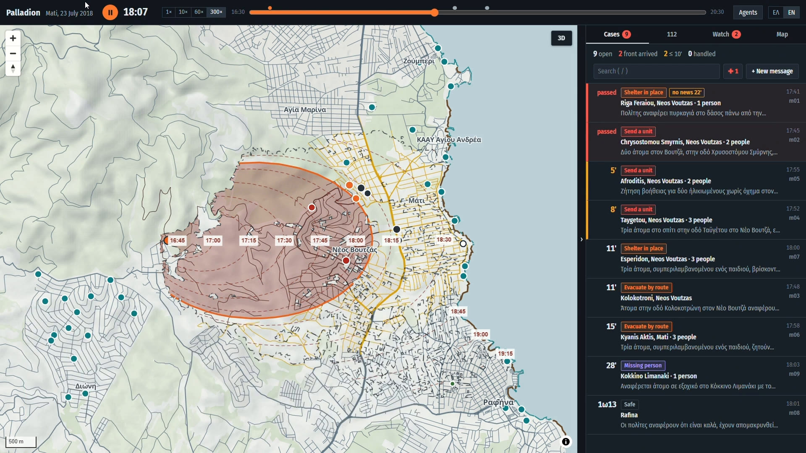
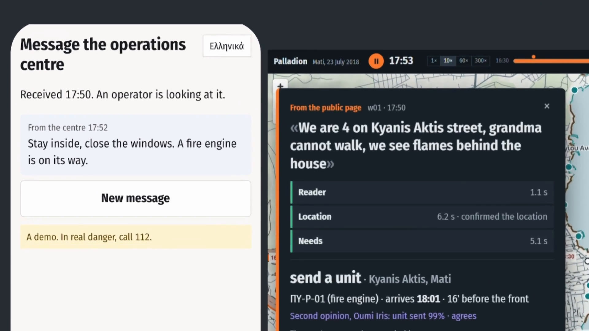
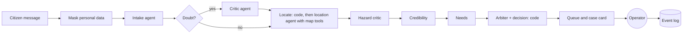

# Palladion

An operations desk for wildfire evacuation and rescue, run by AI agents and decided by people. It replays the
fire at Mati, Greece (23 July 2018) minute by minute: citizen messages arrive, agents read them, code checks
every claim against the fire, the roads and the map, and an operator approves or changes each proposal.

**Agents propose. Code verifies. A person decides.** Nothing that moves people or units happens without a
click, and every human action is written to a hash-chained event log.



> A reconstruction for training and research. The fire front is an estimate from a few sourced points, not a
> physical fire model. All messages and names are synthetic. Not for operational use.

## What it does

- **Queue.** Every message becomes a case with a proposed decision, the reasons for it, and a deadline: the
  minutes until the front arrives, or a medical deadline if that is sooner.
- **Case card.** The message with verified quotes highlighted, what each agent checked, contradictions between
  sources, likely duplicates, and approve or change.
- **Public page (`/send`).** Anyone with the link writes to the desk from a phone. The message goes through the
  same agents into the same queue. The phone shows progress, answers the desk's questions, and receives the
  operator's decision and reply. The desk shows each new message full-screen with each agent's timing.
- **Units.** Code picks the land unit that arrives first on a route that is safe in time (before the front, or
  after it has passed, never while burning). A send waits 10 seconds for undo.
- **112 and Coast Guard.** Cell-broadcast warnings by settlement, with the instruction set by code (drive out
  only if a route has margin, otherwise stay inside or walk to an accessible shore, never to a cliff). Requests to
  the Coast Guard grouped by stretch of shore.
- **Watch.** A supervisor raises what is slipping every 10 scenario minutes; a shift handover summary on request.
- **Second opinion.** Oumi Iris, a decision model, reads the same message; code shows whether it agrees.
- **Greek and English.** The desk and the public page switch language; citizen messages stay as written.



## How it works



Agents run one after another, most only when code finds a reason. Each output is validated against a schema;
every extracted field must quote the message word for word; every number an agent writes must come from facts
code computed. When a check fails, a fixed template or the code's own rule is used instead, and the card says so.

15 Gemini agents in total: intake, critic, location, hazard critic, credibility, needs, duplicates, call-back
questions, contradiction question, 112 writer, Coast Guard liaison, crew brief, field report reader, supervisor
and shift handover. Details in [docs/ARCHITECTURE.md](docs/ARCHITECTURE.md).

## Quick start

Requirements: Python 3.11+, Node.js 20+, and a Google Cloud project with Vertex AI (or a Gemini API key).

```bash
# 1. Backend
cd backend
python -m venv .venv && source .venv/bin/activate      # Windows: .venv\Scripts\Activate.ps1
pip install -e ".[dev,pipeline]"
pytest -q

# 2. Map data (once, 1-2 minutes): OpenStreetMap, Copernicus EMS, ERA5 wind, elevation
python -m palladion.datasets.fetch

# 3. Model access
cp .env.example .env                                   # set PALLADION_GCP_PROJECT
gcloud auth application-default login
python -m palladion.llm.check

# 4. Run
uvicorn palladion.api.app:app --port 8000
cd ../frontend && npm install && npm run dev
```

Open <http://localhost:5173> for the desk and <http://localhost:5173/send> for the public page, then press ▶.
Model answers are cached on disk, so replaying the same scenario does not call the model again. Without model
access the code rules still run and the card shows which agents did not answer.

To host it on a single machine, `deploy/boxd.sh` installs everything and writes a start script; set
`PALLADION_ROOM_KEY` so the desk opens only with `/?key=...` while `/send` stays public.

## Configuration

Settings are environment variables with the `PALLADION_` prefix, read from `backend/.env`
(see [`backend/.env.example`](backend/.env.example)).

| Variable | Purpose |
|---|---|
| `LLM_PROVIDER` | `vertex`, `gemini` or `replay` (cached answers only) |
| `GCP_PROJECT`, `GCP_LOCATION` | Vertex AI project and location |
| `GEMINI_API_KEY` | Gemini API instead of Vertex AI |
| `OUMI_API_KEY`, `OUMI_PROJECT` | Optional second opinion |
| `ROOM_KEY` | Locks the desk when hosted |
| `FRESH_START` | Archive the event log on every start |

## Evaluation

| Set | Messages | Decision | Dangerous errors | Location |
|---|---|---|---|---|
| Sealed (unseen by the code) | 33 | 33/33 | 0 | 23/26 |
| Development | 40 | 40/40 | – | 33/36 |
| Adversarial (empty, huge, HTML, injected orders…) | 25 | 25/25 reach a person, no errors | – | – |

A dangerous error is telling people they are safe when someone should move. Commands and details in
[docs/EVALUATION.md](docs/EVALUATION.md). There is also a red team: an attacker agent writes misleading
messages in 15 categories and code judges the desk's answers (`python -m palladion.redteam.run`).

## Repository

```
backend/palladion/
  api/          FastAPI app and state
  agents/       the agents and the Iris second opinion
  pipeline/     masking, location, decision, arbiter, duplicates
  cases/        queue, versions, contradictions, call-back simulator
  engines/      fire, roads, buildings, shore, 112 areas, unit routing, event log
  missions/ field/ alerts/ coastguard/ supervisor/ handover/ flow/
  live.py       public page          i18n.py   Greek to English for code-written text
  llm/          Vertex AI / Gemini / replay client, cache, budget, call log
  eval/ redteam/ datasets/
frontend/src/   desk (React, TypeScript, MapLibre) and public page (send/)
scenarios/      the Mati scenario: times, places, sources, units, synthetic messages
eval/           development, adversarial and field sets; sealed-set template; red-team regressions
deploy/         single-machine setup
```

## Data and sources

Roads, buildings, coastline and place names from OpenStreetMap; burned area and building damage from Copernicus
EMS (EMSR300); wind from Open-Meteo (ERA5); elevation from terrain tiles. Every time and place in
`scenarios/mati_2018/scenario.yaml` carries its source and a confidence level (`documented`, `derived`,
`approximate`). Land units are illustrative, not the 2018 deployment.

Known limits: the front is an ellipse through three sourced points, confined to a perimeter published after the
fire; routing assumes free-flowing traffic.

Built with Gemini on Vertex AI, Oumi Iris and boxd at the GenAI Summit Athens 2026 hackathon.
